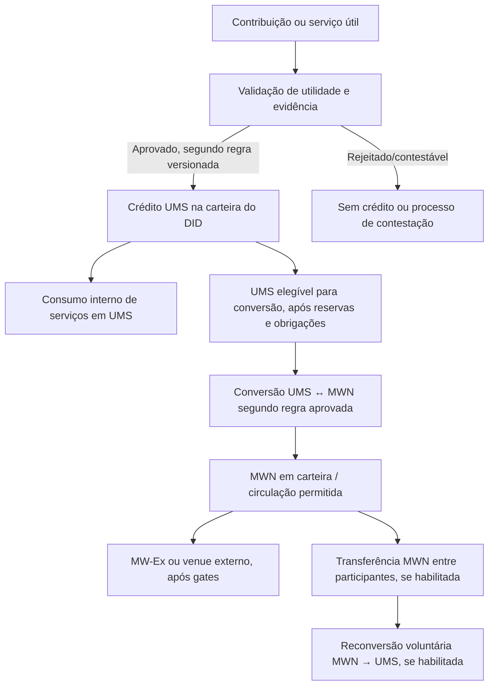

# MISSION_0018 / Task 18.2 — Arquitetura econômica UMS ↔ MWN e tokenomics

**Versão:** 0.1.0-DRAFT_FOR_OWNER_DECISION  |  **Data:** 2026-11-08  |  **Status:** análise documental; nenhuma decisão definitiva aprovada.

## 1. Objetivo e limites

Este documento organiza a arquitetura econômica UMS ↔ MWN para decisão do responsável. Ele não fixa supply, emissão, preço, direitos, conversão, liquidez, custódia, oferta, nem parâmetros finais. Os termos “MWN” e “UMS” são usados de acordo com a nomenclatura registrada, mas o código/piloto ainda contém artefatos legados “MWC”.

Escopo desta unidade: separar o estado documentado/implementado, os princípios expressos pelo responsável, as alternativas arquiteturais e as decisões ainda necessárias. O documento é uma base para decisão e comunicação, não uma especificação normativa aprovada nem aconselhamento jurídico/financeiro.

## 2. Estado atual — o que a evidência permite afirmar

| Elemento | Evidência e classificação | Limite atual |
|---|---|---|
| Identidade da moeda | MWN é a nomenclatura atual informada pelo responsável; crosswalk MWN↔MWC foi registrado. | A identidade nominal não aprova a definição completa, supply, direitos, emissão, utilidade, preço ou mercado. |
| UMS / ledger | Há ledger Supabase de piloto e frontends com leitura de ledger; aquisições são registradas após validação administrativa no fluxo documentado. | Piloto controlado; não prova economia distribuída, emissão PoUW independente ou adoção em escala. |
| Contabilidade UMS-first | O modelo contábil de 04/11 documenta UMS como saldo efetivo e MWN como equivalência potencial/comercial; conversão para negociação está indisponível na Fase 1. | É uma regra documental de Fase 1; fluxos comerciais completos continuam em revisão/gate. |
| Transferências UMS | O piloto declara bloqueio de transferências diretas de UMS entre MeshWalkers e os documentos econômicos mantêm essa regra como princípio. | O bloqueio está em controles do piloto Supabase, não em consenso descentralizado. |
| MWN / mercado | MW-Ex está presente como preview visual, explicitamente não funcional. | Não há ordens, matching, negociação, liquidação, custódia ou liquidez comprovadas. |
| Genesis | Há registros de Genesis e conversão no piloto, com estado não canônico; o Genesis oficial ainda não foi autorizado. | O saldo/quantidade do piloto não deve ser tratado como supply normativo ou emissão final. |
| PoUW | O princípio documental é reconhecer contribuição útil, não mero consumo de CPU/atividade. PoUW foi conceitualmente ampliada para contribuições mensuráveis, inclusive financeiras e aferição opcional de serviços. | Classes, critérios, coeficientes, remuneração, antifraude, contestação e limites não estão todos normatizados/implementados. |
| Carteira | Princípio registrado: unidade econômica é o MeshWalker/DID com carteira lógica unificada, não cada nó. | Especificação técnica e integração ainda não validadas integralmente. |

## 3. Arquitetura-base proposta para discussão

### 3.1 Separação de funções

- **UMS — unidade interna de contabilização/utilidade:** representa contribuição útil reconhecida e capacidade/serviços consumidos dentro do ecossistema. Não é automaticamente dinheiro fiduciário, MWN negociável, nem saldo resgatável.
- **MWN — ativo de circulação externa:** ativo fungível proposto para conectar a economia interna ao mercado externo e permitir a circulação entre participantes, se as regras aprovadas o habilitarem.
- **BRL/EUR/outros fiduciários:** saldos e liquidação fiduciária só existem quando a operação de pagamento/recebimento é efetivamente realizada e reconciliada. Uma conversão interna não cria moeda fiduciária.
- **Carteira do MeshWalker:** saldo lógico consolidado por DID; nós associados contribuem/consomem e mantêm proveniência por evento, mas não geram carteiras econômicas separadas por hardware.
- **MW-Ex:** camada de mercado planejada, separada do ledger interno; precisa de regras de ordens, matching, execução, liquidação, custódia/controle, auditoria, segurança e conformidade.

### 3.2 Fluxo econômico conceitual

**Atenção:** o diagrama é uma proposta conceitual. Não afirma que o fluxo completo esteja implementado. O fluxo de aquisição primária atual é distinto: solicitação, comprovação, validação administrativa e crédito de UMS no ledger, conforme o modelo contábil/documentação de newsite.

## 4. Princípios já registrados versus decisões abertas

| Tema | Princípio/contexto registrado | Decisão que continua aberta |
|---|---|---|
| Nome | MWN é o nome atual da moeda; MWC é legado em fontes e código. | Crosswalk técnico completo, cadeia/ativo canônico e migração de consumidores. |
| UMS | Unidade interna; reconhecimento por PoUW útil; UMS não deve ser transferida diretamente entre MeshWalkers comuns. | Fórmula, classes de contribuição, coeficientes, limites, reservas, eventos de emissão, contestação e anti-fraude. |
| DID/carteira | Um MeshWalker por DID e carteira lógica unificada para múltiplos nós. | DID, onboarding, custody/signing, recuperação, vínculo/desvínculo de nós e integração. |
| MWN | Ativo para circulação e conexão com mercado externo; conversão deve ser voluntária/explicitamente autorizada. | Direitos, finalidade legal, supply, emissão, transferibilidade, fees, mecanismos de conversão e resgate. |
| Conversão UMS↔MWN | 1.000:1 aparece em documentos de piloto/referência; não há aprovação normativa inequívoca. | Se taxa é fixa, variável, mercado/ordem, on-demand; como evitar arbitragem e garantir transparência sem prometer liquidez. |
| Supply / Genesis | Genesis é uma alocação inicial finita em documentos de arquitetura; Genesis oficial exige auditoria, aprovação, assinatura/custódia e verificação independente. | Supply total/cap, quantidade Genesis, destinatários, cronograma, regras de emissão futura e tratamento de excedentes/queima. |
| Mercado | MW-Ex é prioridade de produto; princípio registrado de prioridade de ordens de MeshWalkers sobre ordens próprias da MeshWave. | Matching, price-time, tipos de ordem, execução parcial, cancelamento, reserva, liquidação, fees, conflito de tesouraria, monitoramento e incidentes. |
| Venue externo | Estratégia atual posterga escolha de exchange externa. | Venue, elegibilidade, custo, liquidez e data só após decisão e gates futuros. |
| PoUW financeiro | Contribuições financeiras úteis podem ser reconhecidas conceitualmente como PoUW. | Critérios de elegibilidade, prova, limites, remuneração, antifraude, contabilidade e revisão tributária. |
| Aferição de serviços | Medição contínua/amostral pode ser opcional; sem adesão, telemetria individual identificável não deve ser persistida/recuperável. | Protocolos, métricas, contratos, homologação, contestação, governança e eventual remuneração em UMS. |

## 5. Alternativas arquiteturais para decisão

### 5.1 UMS — remuneração e mensuração

| Alternativa | Descrição | Benefícios | Riscos / dependências |
|---|---|---|---|
| A — tabela normativa de fatores por classe | Cada classe de contribuição útil tem métrica/fator versionado, evidência, validação e limite. | Transparência e auditabilidade; permite comparar classes. | Benchmark, revisão econômica, antifraude e risco de dupla contagem são complexos; fator inadequado distorce incentivo. |
| B — valor de referência baseado em benchmark | Medir workloads reprodutíveis e escolher fatores por hardware/classe, sem converter automaticamente em BRL. | Rastreabilidade técnica e comparabilidade. | Benchmark ainda DRAFT; fatores não aprovados; cargas atuais não cobrem todo o ecossistema. |
| C — híbrido: fatores base + regras de utilidade/qualidade | Combinar medida técnica com aceite de utilidade, qualidade, demanda legítima e limites. | Evita remunerar somente consumo de recurso; alinha com PoUW. | Requer avaliação, critérios contestáveis, dados e governança para evitar subjetividade. |

**Leitura preliminar:** a direção mais coerente com os princípios documentados é não remunerar apenas PoW/consumo de recursos; UMS exige utilidade verificada e mensuração versionada. Isso é uma recomendação de desenho, não uma decisão de coeficientes.

### 5.2 Oferta de MWN e emissão

| Alternativa | Descrição | Benefícios | Riscos / decisões necessárias |
|---|---|---|---|
| A — supply fixo e Genesis finita | Define supply/cap e alocação inicial auditada; futuras contribuições podem receber UMS sem emissão automática de MWN. | Simplicidade da oferta; reduz incerteza de emissão. | Requer definir supply, alocação, direitos, custódia, auditoria e mecanismo de conversão. |
| B — emissão de MWN vinculada a PoUW | MWN seria emitido diretamente em função de contribuição útil. | Liga oferta do ativo a atividade do ecossistema. | Alto risco de inflação e de misturar UMS com ativo de mercado; precisa de fórmula, cap, segurança e revisão. |
| C — híbrido: Genesis + emissões/convertibilidade sob regras limitadas | Genesis finita; UMS reconhece contribuição; MWN só é materializado por conversão/mercado sob limites. | Mantém separação de função entre unidade interna e ativo externo. | Complexidade de reserva, conversão, arbitragem, cap, burn/reemissão e liquidez; requer decisões explícitas. |

**Nenhuma alternativa está selecionada.** O documento normativo v0.1 de network mantém emissão, supply, preço, liquidez e conversão em A_CONFIRMAR/fora do escopo.

### 5.3 Conversão UMS↔MWN

| Alternativa | Descrição | Risco crítico |
|---|---|---|
| A — taxa protocolar fixa | Conversão a uma relação constante, por exemplo a referência histórica 1.000 UMS : 1 MWN. | Se o preço externo flutuar, pode haver arbitragem, pressão de conversão/resgate e obrigação implícita; não garante liquidez. |
| B — taxa variável/market-derived | Conversão atrelada a preço/mercado observável ou mecanismo de cotação. | Necessita mercado, oráculo, regras de slippage, transparência e proteção contra manipulação; preço pode não existir em mercado ilíquido. |
| C — conversão sob demanda via reserva/mercado | O usuário autoriza a conversão somente quando uma operação real exige MWN; a reserva/mercado determina disponibilidade. | Exige regra de elegibilidade, reserva, execução, falha e reconciliação; não pode prometer conversão imediata. |
| D — sem conversão até gate MW-Ex | Mantém UMS interna e adia a conversão comercial até definição/validação. | Atrasa exposição externa, mas evita antecipar mecanismo não definido. |

**Referências quantitativas não normativas a reconciliar:** 1.000 UMS = 1 MWC/MWN aparece em runbook/modelo contábil de piloto; `1.000 UMS = 1 MWN = R$1,00` aparece como parâmetro do simulador; UI/configuração usa outra referência BRL; o controle D-005 diz que 1 MWC = 1.000 UMS não é norma nem preço. Não combinar esses valores nem comunicá-los como paridade ou preço aprovado.

### 5.4 Transferibilidade e carteira

Base conceitual a preservar:
- UMS não é transferível diretamente entre carteiras comuns de MeshWalkers.
- Carteira econômica consolidada por DID; recursos/nós agregados não são titulares econômicos independentes.
- MWN pode ser a camada de circulação entre participantes, se a regra for aprovada e implementada; conversão e transferência são eventos distintos.
- Transferibilidade externa, custódia, signing keys, recuperação, fees e permissões devem ser especificados; o estado atual do piloto não comprova essas capacidades.

## 6. Riscos econômicos e controles necessários

| Risco | Causa possível | Controle/gate proposto |
|---|---|---|
| Emissão sem utilidade | Recompensar só CPU, storage, tráfego ou autoindução de demanda | PoUW com prova de utilidade, classe elegível, idempotência, limites e contestação |
| Dupla contagem | Mesmo trabalho/evento remunerado em múltiplos nós ou modalidades | IDs únicos, provenance, reconciliation, anti-replay e regras de titularidade DID |
| Arbitragem UMS↔MWN | Taxa fixa interna + preço externo variável | Definir taxa/mecanismo, reservas, slippage, contingência e não prometer paridade |
| Genesis/supply inconsistente | Dados históricos de piloto tratados como supply final | Auditoria independente, artefato canônico assinado, supply e reconciliação aprovados |
| Conflito de tesouraria | Exchange própria e emissor participam do mercado | Prioridade de ordens MeshWalker codificada no matching engine; contas próprias/relacionadas identificáveis e auditáveis |
| Liquidez insuficiente | Falta de compradores/vendedores ou de reserva | Não garantir liquidez; política de mercado e disclosures; external venue permanece decisão futura |
| Custódia/segurança | Wallet/market não possui key lifecycle, controls, response | Threat model, custody/signing, authorization, tests, audit and incident procedures |
| Risco regulatório/tributário | Ativo, conversão, venda e contribuições podem ter tratamentos distintos | Parecer jurídico/fiscal por jurisdição; consulta RFB está protocolada, sem resposta confirmada no registro |
| Privacidade/telemetria | Aferição de serviços pode vincular desempenho a usuário | Opt-in explícito, minimização, retenção/deleção, unlinkability quando não aderente e governança independente |

## 7. Fases sugeridas — sem aprovação de cronograma

1. **Fase documental:** identidade MWN, UMS, fluxos, termos, fontes, riscos e decisões aprovadas; reconciliar MWC legado.
2. **Fase UMS de serviço:** benchmark, PoUW, ledger, DID/carteira, emissão e consumo com critérios reproduzíveis e gates técnicos.
3. **Fase MW-Ex mínima:** especificar e validar ordens, matching, saldos reservados, conversão, liquidação, segurança, custódia, logs e prioridade MeshWalker; atualmente a UI é apenas preview.
4. **Fase externa futura:** venue e integração externa só após decisão expressa, elegibilidade, conformidade, segurança, liquidez e disclosures.

## 8. Registro de decisões humanas necessárias

1. Confirmar finalidade/direitos jurídicos do ativo MWN e sua relação com UMS.
2. Escolher modelo de supply: cap fixo, emissão PoUW ou híbrido; definir Genesis e cronograma somente após auditoria.
3. Decidir se a relação 1.000 UMS : 1 MWN é referência ilustrativa, taxa protocolar, taxa variável ou descartada; separar qualquer referência BRL.
4. Definir se conversão UMS→MWN é sob demanda, por pool/reserva, market-derived ou fica bloqueada até MW-Ex.
5. Definir tratamento de MWN na reconversão: burn, reserva/reemissão ou outro mecanismo, com reconciliação.
6. Aprovar as classes de PoUW, benchmark, fatores, critérios de utilidade, antifraude e contestação.
7. Aprovar regras de carteira/DID, transferibilidade MWN, custody/signing e recovery.
8. Aprovar regra de mercado MW-Ex: matching, prioridade MeshWalker, fees, reserva, liquidação e conflitos.
9. Definir os gates legais/fiscais/regulatórios, de segurança, operação e comunicação antes de uso externo.

## 9. Fontes canônicas e proveniência

- [MISSION_0018 README](README.md) e [Blueprint](BLUEPRINT.md): decisões estratégicas, limites e gates.
- [newsite accounting model (04/11/2026)](https://github.com/meshwave65/newsite/blob/main/docs/modelo-contabil-ums-mwn.md): estado documental de Fase 1 e conversão comercial pendente.
- [network MWN↔MWC reconciliation (29/10/2026)](https://github.com/meshwave65/network/blob/main/docs/blueprints/MWN_MWC_RECONCILIATION_2026-10-29.md): D-005/D-006, crosswalk e decisões pendentes.
- [network normative blueprint v0.1](https://github.com/meshwave65/network/blob/main/docs/blueprints/MESHWAVE_BLUEPRINT_NORMATIVE_v0.1.md), [DECISIONS.md](https://github.com/meshwave65/network/blob/main/docs/blueprints/DECISIONS.md), [requirements matrix](https://github.com/meshwave65/network/blob/main/docs/blueprints/requirements_matrix.csv): UMS factors and MWN emission/price/liquidity/conversion remain unapproved.
- [Foundation_MeshWave economic model](https://github.com/meshwave65/Foundation_MeshWave/blob/main/BCE/temas/economia-ums-mwn-pouw-liquidez-distribuida.md): conceptual PoUW, UMS, MWN, wallet and market principles; not implementation proof.
- [Unified MeshWalker wallet/DID](https://github.com/meshwave65/Foundation_MeshWave/blob/main/BCE/temas/economia-centrada-no-meshwalker-carteira-unificada.md), [market governance](https://github.com/meshwave65/Foundation_MeshWave/blob/main/BCE/temas/governanca-mercado-mwn-prioridade-meshwalkers.md), [optional service quality measurement](https://github.com/meshwave65/Foundation_MeshWave/blob/main/BCE/temas/afericao-servicos-qualidade-e-privacidade.md).
- [Blockchain Genesis policy](https://github.com/meshwave65/meshwave-blockchain/blob/main/docs/GENESIS.md), [pilot runbook](https://github.com/meshwave65/meshwave-blockchain/blob/main/docs/PILOT_RUNBOOK.md), [G4 UMS prototype report](https://github.com/meshwave65/network/blob/main/docs/blueprints/G4_UMS_RECONCILIATION_REPORT.md), [reference benchmark v0.1](https://github.com/meshwave65/network/blob/main/docs/blueprints/UMS_REFERENCE_BENCHMARK_v0.1.md).

## 10. Estado

**DRAFT_FOR_OWNER_DECISION.** This document proposes architecture and options only. No final tokenomics parameter has been selected. Any decision must be registered in the normative source with owner/approver, date, evidence, impact, version and explicit approval; do not modify historical documents by blanket renaming.

## 11. Matriz compacta de decisão (2026-11-08)

A matriz completa de decisão está em [DECISION_MATRIX_18_2.md](DECISION_MATRIX_18_2.md). Ela apresenta um baseline conceitual para revisão e mantém todos os parâmetros não aprovados como decisões humanas pendentes.
