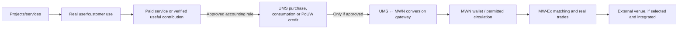

# MISSION_0018 / Task 18.5 — Portfólio de projetos como submissões estratégicas

**Versão:** 0.1.0-DRAFT_FOR_OWNER_DECISION | **Data:** 2026-11-08 | **Status:** mapa de portfólio/evidência; demanda e valor são hipóteses, não fatos de mercado.

## 1. Tese de portfólio

MWN é a camada econômica/mercado pretendida para um ecossistema MeshWave de serviços, processamento/armazenamento e aplicações. O valor de uma frente para MWN não decorre apenas de sua existência: precisa passar por utilidade entregue, usuário/cliente real, transação econômica verificável, regra UMS/MWN aprovada e mercado com liquidez.

**Estado factual agregado:** existem fontes de software, portal público, frontend de carteira, ledger/pilotos controlados, simuladores e conceitos registrados. O conjunto não está comprovado como ecossistema integrado em produção. MW-Ex é preview não funcional; as frentes futuras não são demanda ou receita atual.

## 2. Mapa de submissões estratégicas

| Frente | Categoria | Estado/evidência | Potencial de conexão econômica com MWN | Demanda potencial | Limites/gates |
|---|---|---|---|---|---|
| **MWN / UMS / MW-Ex** | Infraestrutura econômica e mercado central | Portal público; wallet frontend; ledger/aquisição piloto; MW-Ex visual preview. | UMS pode contabilizar utilidade/contribuição; conversão UMS↔MWN e mercado podem conectar atividade à circulação MWN após aprovação. | **Direta**, se serviços/fees/market operations exigirem UMS/MWN; hoje não há mercado operacional. | Tokenomics, supply/Genesis, conversão, custody, matching, security, legal, liquidity and venue are gates. |
| **MeshWalker / processamento e armazenamento federado** | Infraestrutura de rede e capacidade | Simulador local, storage prototype e node-agent lab; no independent multi-node production network proven. | Providers could receive UMS for useful verified work; service consumers could spend UMS. | **Direta potencial** via service consumption and PoUW; currently prototype/lab. | No verified active node count, installed capacity, independent replication, production PoUW or UMS issuance at scale. |
| **SOFIA / SWE** | Primeiro produto de software/knowledge capture | FastAPI tasks/files/search code and online Selenium extraction/upload source; deployment/E2E not independently revalidated. | SWE usage can create service demand and workloads; UMS payments/consumption or external revenue must be defined, not assumed. | **Direta potencial** if a real paid service uses UMS; otherwise indirect B2B revenue/workload. | Runtime, reliability, customer adoption, price, service-to-UMS rules and production readiness remain open. |
| **Condenser** | AI efficiency/productivity software | Frontend and Groq-backed API modes exist in code; owner assesses maturity as near-MVP, but benchmark and runtime not independently validated. | Paid optimization services may create recurring workload; any UMS/MWN usage must be explicitly defined. | **Direct product demand potential**, but not current token demand without approved payment/use rule. | Benchmark quality, semantic preservation, endpoint operation, token/energy savings and commercial adoption unverified. |
| **MIA-D / Global Aquometer** | Sustainability measurement/methodology | Methodology is evolving per owner; repository contains visual counter with fixed rate, not measured avoided impact. | Potential B2B reporting/measurement product; could support trust, partner engagement or service use. | **Indirect / option value** until methodology is validated and an economic payment path is defined. | No approved definitive method, instrumentation, independent validation, certification or measured savings. |
| **Jardim do Éden** | Consumer/game engagement and MeshWalker acquisition | Concept/project folder; README says scope/criteria not defined; no game build, license or integration evidence. | Could bring users into MeshWalker network and create voluntary resource contribution/organic demand if developed and adopted. | **Indirect adoption option**, not direct token demand now. | No development, licensing/partnership, gameplay integration, users or recurring demand proven. |
| **Aferição opcional de serviços / QoS** | Trust/quality measurement for providers/customers | Concept recorded; technical specification, protocols, governance, homologation and implementation pending. | Verified service quality could become useful PoUW and support demand for network services. | **Indirect/direct future**, conditional on opted-in measurement, validated protocol and approved UMS recognition. | Privacy by adhesion, metrics, contract, dispute, governance and remuneration remain open. |
| **ORP / sports telemetry** | Adjacent B2B data/telemetry concept | Concept/invention; no implementation, partner or validated market. | Could generate processing/storage/data workloads for MeshWave if commercialized and integrated. | **Optional indirect demand**; outside core MWN thesis until validation. | No pilot, customer, rights, sports integration or UMS/MWN economic link. |
| **Token launch benchmark / market research** | Research and decision support | Retrospective reports and draft materials; source metrics heterogeneous and confidence limits recorded. | Supports market strategy and investor communication; does not itself create token demand. | **Indirect strategic input**, not economic utility. | No predictive guarantee; do not extrapolate token performance or MWN ROI. |

## 3. Demand/value chain — conditional, not automatic

- **Observed today:** public informational website; wallet/acquisition frontend; controlled UMS ledger/pilot; software/prototype artifacts.
- **Not observed as operational:** public MWN market, UMS↔MWN commercial conversion, active MW-Ex order matching, external listing, guaranteed liquidity, or project-generated recurring token demand.
- Each future arrow requires a defined economic event, a versioned accounting rule, implementation, tests and evidence. A project can create revenue/workload without creating demand for MWN unless the payment, conversion or market mechanism explicitly connects it.

## 4. Portfolio tiers for investor submissions

### Tier 1 — Core economic/market thesis

**MWN + UMS + wallet + MW-Ex.** This is the investment focus: a distinct internal utility/accounting layer and a planned external market layer. Evidence currently supports a public portal, authenticated wallet frontend and controlled ledger pilot; the exchange remains a preview. Capital would professionalize and integrate the market architecture, subject to approval and readiness gates.

### Tier 2 — First monetizable software services

**SOFIA/SWE and Condenser.** These are the most concrete software-product submissions in the portfolio. Their strategic role is to deliver real service value and workloads that may later connect to UMS and the network. Current evidence is code-level; deployment, customer adoption, pricing, quality benchmarks and actual token demand remain unverified.

### Tier 3 — Network capacity and supply-side growth

**MeshWalker processing/storage.** The strategic goal is a voluntary, configurable contribution of selected resources in return for verified useful work, with UMS recognition under approved PoUW rules. Current evidence is local simulation/lab, not an active distributed production network.

### Tier 4 — Adoption and trust options

**Jardim do Éden and optional QoS measurement.** These can become user-acquisition and service-trust pathways. Both are concept-stage; neither should be represented as developed, licensed, integrated or producing demand.

### Tier 5 — Impact and adjacent optionality

**MIA-D and ORP.** MIA-D may become a B2B impact measurement method/product, but must be validated. ORP is an adjacent telemetry concept that may use distributed processing/storage. Neither is a current MWN demand source.

## 5. Short investor-safe submission drafts

### MWN / MeshWave

MeshWave is developing an ecosystem in which UMS is intended to account for useful contributions and internal service activity, while MWN is the planned external market asset. The portfolio already contains a public portal, wallet frontend, controlled ledger pilot and several software/prototype artifacts. The investment thesis is to professionalize and integrate these layers; MW-Ex is currently a visual preview, and no listing, liquidity or price is guaranteed.

### SOFIA / SWE

SOFIA is the cognitive/knowledge layer of the MeshWave proposal, with SWE focused on capturing AI conversation knowledge and preserving reusable artifacts. FastAPI task/file/search code and an online extraction path exist. The first commercial opportunity is a real software service; deployment, reliability, customer adoption, pricing and any UMS/MWN payment path must still be validated.

### Condenser / MIA-D

Condenser is an AI query/prompt optimization product with frontend and Groq-backed service code. MIA-D is an evolving methodology intended to assess impact, but the current repository counter is demonstrative rather than measured environmental impact. The investment opportunity is productization, benchmark and method validation—not a claim of already quantified savings or certified impact.

### Federated processing/storage

MeshWalker is intended to support voluntary resource contribution and useful-work recognition. Current evidence is a local simulator, storage prototype and lab node-agent; independent multi-node replication, production PoUW and active network capacity are not proven. The network thesis is future service capacity and potential recurring demand, conditional on adoption and implementation.

### Jardim do Éden

Jardim do Éden is a concept for a consumer/game engagement pathway that could invite voluntary MeshWalker participation and create organic network adoption. Its scope remains unapproved in the inspected project README; there is no evidence of a developed game, license, integration, users or resulting MWN demand.

### Optional service-quality measurement

An optional, privacy-by-adhesion service could measure provider availability and service commitments through open/verifiable protocols, potentially creating a useful PoUW activity. The concept is recorded, but technical metrics, governance, consent/retention, homologation, dispute handling and implementation remain pending.

## 6. Evidence and communication guardrails

- Distinguish **current operation**, **implemented source**, **pilot/lab**, **development**, **owner-reported concept**, and **roadmap** in every submission.
- Do not say “the ecosystem generates recurring MWN demand” as a current fact. Say “the architecture is designed to connect service utility and verified contributions to UMS/MWN, subject to implementation and adoption.”
- Do not equate UMS credits, primary acquisitions, Genesis distribution or internal accounting with secondary trading volume or market liquidity.
- Do not present MIA-D's visual counter as measured impact, Condenser as benchmark-proven, Jardim do Éden as licensed/developed, or the federated network as production.
- A project's existence does not guarantee MWN price, value, demand, revenue, ROI or investment return.
- Investor format should remain short/objective: 1–2 paragraphs per idea, one concise summary page, a detailed phase/evidence page and a contact path; do not prepare a one-page dossier for every project.

## 7. Sources

- [18.1 consolidated evidence matrix](EVIDENCE_MATRIX_18_1.md) and detailed inventory.
- [18.2 UMS↔MWN architecture draft](ARCHITECTURA_ECONOMICA_UMS_MWN_DECISION_DRAFT.md) and [decision matrix](DECISION_MATRIX_18_2.md).
- [18.3 market strategy](ESTRATEGIA_MERCADO_E_LISTAGEM_18_3.md) and [18.4 MW-Ex readiness](MWEX_MVP_SCOPE_OPERATION_READINESS_18_4.md).
- [SOFIA/SWE backend](https://github.com/meshwave65/SofiaWebExtractor/blob/main/backend/main.py), [online extractor](https://github.com/meshwave65/engines/blob/main/universal_extractor-online.py), [Condenser service](https://github.com/meshwave65/sofia/blob/main/engine/condenser_pro_service.py), [MIA-D GlobalAquometer](https://github.com/meshwave65/sofia-mia/blob/main/src/components/GlobalAquometer.vue).
- [Storage prototype V0](https://github.com/meshwave65/network/blob/main/projects/mwc/blueprints/PROTOTIPO_ARMAZENAMENTO_VOLUNTARIO_V0.md), [Jardim do Éden README](https://github.com/meshwave65/network/blob/main/projects/jardim-do-eden/README.md), [optional service-quality concept](https://github.com/meshwave65/Foundation_MeshWave/blob/main/BCE/temas/afericao-servicos-qualidade-e-privacidade.md).
- [Preliminary investor document](https://github.com/meshwave65/Foundation_MeshWave/blob/main/BCE/temas/documento-base-investidores-mwn.md), [token launch benchmark Stage 03](https://github.com/meshwave65/Foundation_MeshWave/blob/main/docs/token-launch-benchmark/reports/2026-11-05-stage-03-mwn-draft-materials.md), [MISSION_0017 economic study](../0017/BLUEPRINT.md).