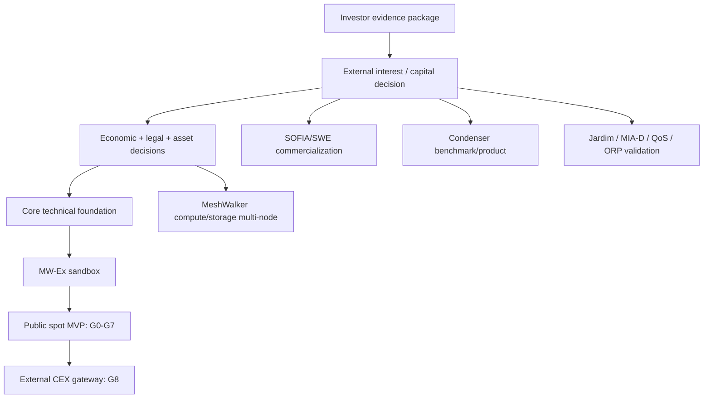

# MISSION_0018 / Task 18.7 — Roadmap integrado de fases, milestones e gates

**Versão:** 0.1.0-DRAFT_FOR_OWNER_DECISION | **Data:** 2026-11-08 | **Status:** roadmap conceitual; não é cronograma contratado, autorização de gasto ou promessa de lançamento.

## 1. Princípios de execução

1. **Validação externa antes de desenvolvimento/custos:** manter o conceito e o pacote de evidências até haver interesse externo qualificado, investimento/partner validation e budget aprovado.
2. **MWN como foco de mercado:** MW-Ex e carteira própria são o canal primário pretendido; venue externa é posterior e não selecionada.
3. **Evidência antes de status:** cada milestone deve provar a funcionalidade, piloto, produção, adoção ou demanda que declara.
4. **Fasear risco:** economia/tokenomics → entidade/legal → arquitetura/custody → sandbox → public spot → external gateway.
5. **Projetos paralelos não criam demanda automaticamente:** SWE/Condenser podem gerar serviço/workload; Jardim/MIA-D/QoS/ORP são opções até validação e vínculo econômico.
6. **ROB como tese, não ROI garantido:** retorno depende de execução, mercado, adoção, liquidez e riscos; nenhum número de retorno é projetado neste roadmap.

## 2. Roadmap integrado

Estimativa: esforço relativo **S/M/L/XL** e confiança. É uma ordem de grandeza de trabalho pós-financiamento, não prazo-calendário. Aprovações regulatórias, listing, investimento, parceiros e liquidez têm calendário externo não estimável. A equipe e capacidade ainda não foram confirmadas.

| Fase / milestone | Entregáveis | Dependências | Gate de avanço | Indicadores | Responsáveis sugeridos | Esforço indicativo |
|---|---|---|---|---|---|---|
| **P0 — Pacote de validação/investidor (atual)** | 18.1 evidence matrix; 18.2 architecture/decision matrix; 18.3 venue strategy; 18.4 MW-Ex gates; 18.5 portfolio map; 18.6 risk matrix; 18.7 roadmap; 18.8 thesis/ROB; short project submissions + summary page + detailed phase page + contact path. | Sources and owner narrative; no code development. | Responsible owner approves facts, narrative and investor target groups; begin outreach only as approved. | Qualified conversations; requests for data room/diligence; written interest/LOI/commitment; objections and missing evidence. | Project owner/strategy; technical reviewer; communications. | **S**; medium confidence (documentary, current evidence base exists). |
| **P1 — External validation and capital decision** | Investor/partner feedback log; selected scope; investment/partner terms; budget, governance and owner roles; validation record. | P0 approved; contacts and target audience selected. | Evidence of qualified external interest and explicit owner approval of funding/scope; no development spend before gate. | Qualified investor interest; diligence progression; written commitment/LOI/term sheet; budget and team capacity. | Owner/strategy; finance; legal for terms. | **S–M** internal effort; calendar **unknown** (external dependency). |
| **P2 — Economic, legal and asset decisions** | Approved MWN/UMS purpose/rights; supply/Genesis; PoUW classes/factors; conversion mechanism; target jurisdiction; legal entity and regulatory path; accounting/tax; asset/chain specification. | P1 capital/partner decision; tasks 18.2 and 18.6 frameworks; professional counsel. | Written owner decisions and counsel-reviewed legal/regulatory architecture; unresolved 1,000:1/BRL references reconciled; no public offer until gate. | Decisions approved/versioned; legal opinions; no unresolved critical classification/custody/FX issue. | Owner/economic lead; legal/tax; compliance; protocol lead. | **L–XL**; low confidence until scope/team/counsel selected. |
| **P3 — Core technical foundation** | Canonical asset/chain or approved ledger design; wallet/DID; double-entry ledger; PoUW/issuance; custody/signing model; API/RLS; reconciliation; security architecture; monitoring. | P2 decisions; funding; engineering/security team. | Invariants pass tests; custody/keys and supply are auditable; independent review plan accepted. | Ledger drift=0 unexplained; issuance/PoUW replay/duplicate tests; wallet recovery tests; API/RLS security tests. | Engineering lead; protocol; security; QA; SRE. | **XL**; low confidence. |
| **P4 — MW-Ex private sandbox** | Matching engine/ledger sandbox; test balances; one test market; order lifecycle; price-time; partial fills/cancel; MeshWalker priority; self-trade prevention; market data; audit logs. | P3 foundation; MW-Ex scope 18.4; no real assets. | G1 sandbox and G2 ledger integrity pass; no real deposits/withdrawals; no public trading claim. | Deterministic matching tests; concurrency/idempotency; no unexplained reserve/ledger drift; simulated user-priority tests; latency/error metrics. | Product; engineering; QA; security; market ops. | **L–XL**; low/medium confidence. |
| **P5 — MW-Ex public spot MVP** | Selected pair; real account eligibility; approved custody; deposits/withdrawals; matching/settlement; fees; KYC/AML/sanctions; privacy; support; market monitoring; disclosures; liquidity policy. | P2 legal/tokenomics; P3 core; P4 sandbox; 18.6 professional reviews. | G0–G7 closed; written owner launch approval; independent security review; legal/compliance sign-off; market-quality thresholds approved. | Successful E2E deposits/withdrawals/trades; reconciliations; uptime; spread/depth; order quality; support/incident metrics; compliance reporting. | Owner; engineering; custody/security; compliance/AML; DPO; SRE; market ops. | **XL**; low confidence; legal/security and liquidity external dependencies. |
| **P6 — External CEX gateway** | Selected venue; written listing terms; technical/wallet integration; deposits/withdrawals; venue-specific compliance, marketing and support. | P5 operation or separately approved readiness; 18.3 due diligence; canonical asset/chain; capital. | Venue due diligence and written terms; jurisdictional/legal review; no fee payment without owner approval and investor validation. | Venue onboarding; integration tests; deposits/withdrawals; real pair spread/depth; delisting/withdrawal risk. | Owner/BD; engineering; legal; compliance; market ops. | **M–L** engineering + external timeline **unknown**. |
| **Parallel A — SOFIA/SWE commercialization** | E2E extractor task/files/search; reliability/latency; packaging/pricing; first customer/paid pilot; service metrics; privacy. | P1 capital/partner; current codebase; scope for first sellable product. | Repeatable demo/test; validated quality; customer interest/paid pilot; no UMS integration until 18.2 rules approved. | Extraction success, latency, search accuracy, artifact quality, user retention, paid pilot and cost per workload. | Product/SWE engineering; QA; sales; privacy. | **M–L**; medium/low confidence. |
| **Parallel B — Condenser** | Service endpoint runtime; benchmark; semantic preservation; product packaging; paid pilot; approved service/UMS linkage. | P1; API/source; test dataset and evaluation plan. | Benchmark and product acceptance; method/impact claims remain separate. | Quality score, token reduction, task success, latency, cost and paid usage. | Product/AI engineering; QA; science/measurement reviewer. | **M–L**; low/medium confidence. |
| **Parallel C — MeshWalker compute/storage** | Multi-node prototype; independent replication; proof/PoUW; resource opt-in; network security and anti-double-counting; service demand integration. | P1; canonical economics/PoUW; node-agent/storage prototype; privacy/security. | Multi-node tests; useful work independently verified; no forced resource share; approved UMS issuance and recovery. | Active independent nodes; uptime; accepted tasks; replication; verified PoUW; error/fraud rates; resource usage. | Network/protocol; security; QA; operations. | **XL**; low confidence. |
| **Option lane — Jardim do Éden** | Scope validation; licensing/rights; concept prototype; user research; MeshWalker opt-in/integration plan. | External interest/partner; scope approval; rights review. | User/partner validation and approved project scope before development. | Qualified user interest; retention; voluntary activation; contribution choices; engagement. | Game/product; legal/IP; growth; network team. | **M** for discovery; **L/XL** development unknown. |
| **Option lane — MIA-D / QoS / ORP** | MIA-D method validation; optional QoS protocol/privacy/governance; ORP technical/market proof. | External interest; method/partner; 18.6 privacy/security gates. | Independent method/technical review and user/partner validation before implementation/claims. | MIA-D measured outcomes/uncertainty; QoS opt-in and verification reliability; ORP pilot/customer. | Product; methodology/science; privacy; engineering; partners. | **M–XL** by project; low confidence. |

## 3. Critical path and parallel lanes

**Critical path:** investor validation → capital/scope → tokenomics/legal/asset → custody/ledger/chain → MW-Ex sandbox → public market gates → external venue.

**Parallel lanes:** SWE/Condenser may pursue product validation and commercial packaging after external interest, but token/UMS linkage waits for approved economics. MeshWalker compute/storage is a larger technical lane. Jardim/MIA-D/QoS/ORP remain optional concept-validation lanes, not critical-path dependencies until selected.

## 4. Advance / pause / stop criteria

| Condition | Decision |
|---|---|
| No qualified external interest/investment after P0 | Pause development spending; maintain concept/evidence package; revise thesis or stop. |
| Token rights/supply/conversion remain ambiguous | Do not mint/convert MWN, market a fixed ratio, or claim a canonical supply. |
| Regulatory entity/authorization path unresolved | No public exchange, custody, fiat rail, public offer or user trading. |
| Custody/security audit or ledger invariants fail | Stop public launch; remediate and retest; no exceptions by marketing schedule. |
| No credible liquidity/market-integrity plan | Do not open public orderbook or present a market price/volume. |
| External venue fails counterparty/regulatory diligence or terms | Do not list or pay; retain MW-Ex strategy or reassess. |
| QoS lacks opt-in/privacy design | Do not persist/identify individual telemetry; keep concept only. |
| MIA-D method not independently validated | No “measured avoided impact”, certification or quantified environmental claim. |
| Jardim lacks rights/partner/user validation | Keep concept only; no development spend. |

## 5. Governance and owner roles

These are **roles to appoint**, not confirmed team members:

- **Project owner / executive sponsor:** approves thesis, capital, scope, tokenomics, launch and external commitments.
- **Product/strategy lead:** prioritization, acceptance criteria, investor submissions and project dependencies.
- **Engineering/protocol lead:** architecture, code, integrations, ledger, chain, wallet and delivery estimates.
- **Security/custody lead + independent auditor:** threat model, keys, smart contracts, penetration tests, recovery and sign-off.
- **Compliance/AML officer:** regulatory classification, KYC/AML, sanctions, Travel Rule, transaction monitoring and reporting.
- **DPO/privacy counsel:** LGPD data map, legal basis, consent, retention/deletion, rights and incident handling.
- **Finance/tax/accounting:** UMS/MWN accounting, treasury, issuance, conversion, reporting and RFB follow-up.
- **Market operations / liquidity:** orderbook, fees, user priority, surveillance, liquidity policy and market quality.
- **Business development / exchange integration:** venue diligence, terms, listing and technical integration; no payment without approval.
- **Independent reviewers:** legal, scientific/MIA-D, market integrity and blockchain/security as needed.

## 6. Roadmap indicators — avoid vanity metrics

- **Validation:** qualified investor/partner discussions, diligence requests, explicit interest/LOI/term sheet; not social impressions alone.
- **SWE/Condenser:** repeatable demo, task quality, latency, cost, paid pilot, customer retention; not repository count.
- **MW-Ex:** actual completed trades, spread/depth, execution quality, ledger reconciliation, uptime, withdrawals, market integrity; not a static UI or synthetic volume.
- **MeshWalker:** independent active nodes, verified useful work, accepted PoUW, uptime, replication and resource opt-in; not self-reported installed capacity.
- **Jardim:** validated user interest, rights, retention and voluntary participation; not concept-only user projections.
- **MIA-D/QoS:** method validation, uncertainty, opt-in, independent measurements and dispute outcomes; not a fixed demo counter.
- **MWN demand:** real UMS consumption/credit and approved MWN conversion/trading; do not equate acquisitions or Genesis with secondary volume.

## 7. Estimate basis and uncertainty

- Effort sizes are relative, based on the complexity of source integration, regulatory/custody/security dependencies and the number of independent acceptance gates. They are not resource-loaded estimates because the team, architecture and budget are not confirmed.
- **S** = bounded documentation/validation work; **M** = one product subsystem or limited integration; **L** = several coupled subsystems and tests; **XL** = core market/network, custody/security, legal and operations combined.
- Calendar duration is not estimated for investor capital, regulatory authorization, legal review, exchange listing, liquidity formation, partnership or customer adoption.
- Re-estimate after P1 when team, budget, technical architecture, jurisdiction and approved scope are known.

## 8. Sources

- [18.1 evidence matrix](EVIDENCE_MATRIX_18_1.md)
- [18.2 economic architecture](ARCHITECTURA_ECONOMICA_UMS_MWN_DECISION_DRAFT.md) and [decision matrix](DECISION_MATRIX_18_2.md)
- [18.3 market strategy](ESTRATEGIA_MERCADO_E_LISTAGEM_18_3.md)
- [18.4 MW-Ex scope/readiness](MWEX_MVP_SCOPE_OPERATION_READINESS_18_4.md) and [gate matrix](MWEX_READINESS_GATE_MATRIX_18_4.md)
- [18.5 portfolio map](PORTFOLIO_STRATEGIC_SUBMISSIONS_18_5.md) and [demand chain](MWN_DEMAND_VALUE_CHAIN_18_5.md)
- [18.6 risk matrix](RISK_AND_COMPLIANCE_MATRIX_18_6.md) and [jurisdiction gates](JURISDICTIONAL_REVIEW_GATES_18_6.md)
- [18.7 integrated roadmap](ROADMAP_INTEGRATED_PHASES_GATES_18_7.md) — this document