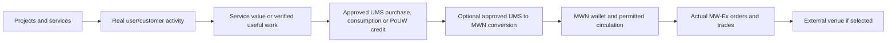

# MWN — Tese de lançamento e proposta ROB
## O ativo de mercado da economia MeshWave, fundamentado por seu ecossistema

**Versão:** 0.1.1-DRAFT_FOR_OWNER_DECISION | **Data:** 2026-11-08 | **Status:** documento de decisão; não é oferta pública, investment solicitation, aprovação de tokenomics ou previsão financeira.

## 1. Resumo da tese

**MWN é o ativo de mercado da economia MeshWave e o objeto central desta tese ROB.** A proposta não é vender os produtos e projetos do ecossistema individualmente. É apresentar um ativo destinado à circulação externa que possui como fundamento uma base tecnológica e econômica: serviços, aplicações, infraestrutura distribuída e mecanismos internos de contabilização de contribuição e consumo.

A **MeshWave é a base da MWN**. O ecossistema dá contexto e possibilidades de utilidade ao ativo, enquanto a UMS organiza a contabilização interna de contribuição útil e consumo de serviços. A MWN é o gateway asset entre essa economia interna e a camada de mercado; a MW-Ex é o canal próprio pretendido. A arquitetura não prevê uma rota alternativa de conversão direta UMS↔outro criptoativo.

A base foi construída pelo trabalho de uma única pessoa — o fundador — com ferramentas e serviços gratuitos da internet e equipamentos extremamente limitados. Ela já inclui componentes funcionais e iniciativas em diferentes estágios. O investimento busca consolidar a economia, fortalecer a infraestrutura e ampliar as condições de utilidade e circulação da MWN. A existência do ecossistema oferece fundamento à tese, mas não significa que cada projeto gere automaticamente demanda, preço ou liquidez.

## 2. O problema e a proposta de valor

### 2.1 Problema

- Serviços, recursos e contribuições de uma rede distribuída precisam de contabilização verificável, regras de utilidade, incentivo e controle.
- A expansão da rede requer serviços que tenham valor real para usuários/clientes, não apenas participação ou capacidade ociosa.
- Uma economia interna e um ativo externo precisam ser separados para não confundir crédito de serviço, remuneração de contribuição, moeda fiduciária, emissão e negociação.
- A própria exchange exige integridade de mercado, custody, reconciliação, segurança, compliance e liquidez; uma interface visual não resolve esses problemas.

### 2.2 Proposta

- **UMS:** unidade interna para contabilizar contribuição útil e consumo de serviços segundo regras aprovadas e versionadas.
- **MWN:** ativo de mercado e gateway da economia MeshWave, conectando a contabilização interna UMS à circulação externa. Direitos, supply, Genesis, emissão e parâmetros finais de conversão ainda dependem de aprovação.
- **MeshWave:** camada de rede e serviços que pode gerar workloads e uso real.
- **MW-Ex:** mercado próprio pretendido como canal primário inicial, hoje somente preview.
- **SWE/Condenser:** produtos de software que podem entregar valor comercial e workloads antes da maturidade completa da rede federada.
- **MIA-D/Jardim/QoS/ORP:** opções de impacto, adoção, confiança e aplicações adjacentes, cada uma com gates próprios.

## 3. Encadeamento de utilidade e demanda

### O que a cadeia significa — e o que não significa

- A existência de um projeto pode gerar interesse, workload ou receita sem criar demanda por MWN.
- Demanda direta por UMS/MWN só existe se uma regra econômica aprovada exigir ou usar o ativo, e o evento ocorrer de fato no ledger/mercado.
- UMS credit, primary acquisition, Genesis allocation and internal accounting are not secondary trading volume or market liquidity.
- Conversion, market price, external listing, liquidity and value are not guaranteed.
- The entire chain above is conceptual; today the ledger is a controlled pilot and MW-Ex is nonfunctional preview.

## 4. Evidência funcional por componente

| Componente | Evidência atual | Papel na tese | Limite de comunicação |
|---|---|---|---|
| MWN / UMS / wallet | Public portal, authenticated wallet frontend, controlled ledger/acquisition pilot, dated accounting model. | Core economic layer and market asset concept. | No approved rights/supply/price/conversion; pilot is not production economy. |
| MW-Ex | Source component and public route exist; explicitly “Em breve”, no orders, prices or trades. | Own primary channel and future market infrastructure. | Not an operational exchange; no matching, settlement, custody, liquidity or trading. |
| Blockchain | Code, pilot ledger and reports; single-operator/noncanonical boundary. | Possible future verifiable asset/ledger layer. | No public distributed production consensus or independent validator network proven. |
| MeshWalker compute/storage | Local simulator, storage prototype and lab node-agent. | Future supply-side capacity and PoUW activity. | No active independent production capacity, replication or large-scale PoUW proven. |
| SOFIA/SWE | FastAPI tasks/files/search and online extractor source. | Potential first sellable software product; knowledge capture and workload. | Deployment/E2E reliability, users, price and recurring demand not verified in this audit. |
| Condenser | Frontend and Groq-backed service code. | AI efficiency product, adjacent to SWE and network workloads. | No benchmark, semantic preservation, measured savings or commercial adoption validated. |
| MIA-D | Evolving methodology; visual counter demo. | Potential B2B impact measurement and methodology product. | No validated method, instrumentation, certification or measured impact. |
| Jardim do Éden | Concept README and project folder. | Potential consumer/game adoption pathway. | No developed game, license, integration, user adoption or MWN demand proven. |
| QoS / optional service measurement | Concept recorded with privacy-by-adhesion. | Future trust/quality layer and potential useful PoUW. | Technical protocol, governance, homologation and implementation pending. |
| ORP | Concept/invention. | Optional B2B telemetry workload. | No implementation, pilot, customer or integration. |

## 5. Por que MWN é o foco

MWN é o ativo central da proposta. A MeshWave não está sendo apresentada como um portfólio de produtos independentes: o ecossistema é a base que dá contexto, estrutura e possibilidades de utilidade ao ativo. A UMS permanece como unidade interna de contabilização; a MWN é a porta de conexão com o mercado externo. A arquitetura reserva à MWN o papel exclusivo de gateway entre UMS e o mercado, sem rota direta UMS↔outro criptoativo.

A tese de valor potencial depende da consolidação de elementos como:

1. um ativo canônico com direitos/supply/regras definidos;
2. UMS como unidade interna com utilidade e emissão verificáveis;
3. serviços que clientes realmente usam e pagam;
4. contribuições úteis com PoUW e critérios antifraude;
5. uma carteira/ledger segura e reconciliada;
6. MW-Ex funcional com market integrity, custody, compliance, market data e liquidez;
7. adoção suficiente para criar demanda, atividade e preço observáveis;
8. eventual venue externa selecionada e integrada.

Esses elementos são os drivers da tese; nenhum é garantido ou completamente implementado hoje.

## 6. Estratégia de mercado

- **Canal primário pretendido:** carteira e MW-Ex próprias, com controle da experiência e do relacionamento MeshWalker; desenvolvimento/custos são condicionados a interesse externo/investimento e orçamento aprovado.
- **Porta pública posterior:** uma exchange externa de menor atrito pode servir de gateway, mesmo que tenha menos alcance/liquidez que Binance.
- **Binance:** candidatura histórica reportada; status atual não verificado e não é estratégia primária.
- **Venue externa:** comparação documental foi explicitamente reaberta e concluída na tarefa 18.3. Não selecionada. LBank e CoinW são apenas candidatos condicionais de diligência; não recomendação, listing ou aprovação. Não houve contato ou pagamento.
- **DEX:** alternativa futura, distinta de CEX; requer chain/contract, audit, pool/liquidity and legal/technical review.
- **Sem promessa de preço, listing, liquidity, volume, redemption, buyback or ROI.**

## 7. ROB — Return On Believe

ROB (Return On Believe — retorno por acreditar) é um conceito narrativo para uma tese de investimento de risco: o investidor acredita que a integração de uma rede de serviços, produtos de software, economia UMS/MWN e mercado próprio pode gerar valor se os milestones forem executados e houver adoção.

ROB não é uma fórmula de retorno, valuation, ROI forecast, token price target or guarantee. O investidor precisa considerar:

- risco técnico e de integração;
- risco de autorização, classificação do ativo e conformidade;
- risco de custody, segurança, fraude e market integrity;
- risco de falta de adoção, receita, demanda e liquidez;
- risco de supply/conversão/tokenomics ainda não decididos;
- risco de atraso, custo, parceiro ou exchange;
- possibilidade de perda total do capital e de a tese não se realizar.

### Linguagem recomendada

“ROB (Return On Believe) descreve o caráter de investimento em uma tese de evolução da MWN, ativo de mercado fundamentado pelo ecossistema MeshWave. O potencial depende da consolidação da arquitetura econômica, da utilidade do ecossistema, da infraestrutura de mercado e da adoção; não é ROI garantido nem promessa de valorização.”

## 8. Cenários qualitativos — sem projeção financeira

| Cenário | Condições | Resultado qualitativo |
|---|---|---|
| **Downside** | Falta de capital/interesse; atraso legal; falha técnica/security; baixa adoção/liquidez; MW-Ex não chega à operação. | Portfólio permanece em conceito/piloto; MWN não estabelece mercado/demanda; investimento pode ser perdido. |
| **Base de execução** | Capital/partner validation; decisões econômicas e legais; produtos de serviço melhorados; sandbox e gates concluídos em fases. | MWN/MW-Ex e serviços tornam-se operacionais de forma controlada; demanda e mercado ainda precisam ser medidos, sem garantia de valor. |
| **Upside** | Serviços são adotados, MeshWalker cresce, UMS é útil, PoUW é confiável, MW-Ex opera com integridade/liquidez e venues ampliam acesso. | Efeitos de rede e demanda recorrente podem emergir; o valor de MWN pode se beneficiar, mas não é garantido nem quantificado. |

Os cenários são narrativos para decisão; não incluem preço, supply, valuation, market cap, revenue forecast or ROI.

## 9. Objetivos de capital relatados — não orçamento ou previsão

O responsável registrou três faixas estratégicas conceituais, que devem permanecer explicitamente atribuídas e não podem ser apresentadas como orçamento aprovado, valuation, promessa de captação ou previsão:

| Fase conceitual | Objetivo declarado | Faixa de capital pretendida |
|---|---|---:|
| Orgânica inicial | Amadurecer o ecossistema, com MW-Ex como canal inicial, após validação externa | R$ 50 mil–R$ 100 mil |
| Acesso público externo, futuro | Avaliar exchange externa como porta pública após MW-Ex/readiness | R$ 250 mil–R$ 500 mil |
| Escala/prestígio, futura | Considerar venue de maior alcance e desenvolvimento mais significativo | Alguns milhões de reais |

A segunda e terceira fases dependem de execução, elegibilidade, segurança, conformidade, mercado, liquidez e decisão humana. Não há alocação percentual ou destinação detalhada aprovada.

## 10. Uso potencial de capital — prioridades, não orçamento

### Prioridade proposta para revisão

1. **MWN/UMS + wallet/ledger + canonical asset + legal/security:** resolver a base econômica, técnica e regulatória.
2. **MW-Ex:** sandbox, matching/ledger, custody, market integrity, compliance, monitoring and launch gates.
3. **First sellable services:** SWE and Condenser, with benchmarks, packaging, customer validation and revenue model.
4. **MeshWalker network capacity:** multi-node processing/storage, PoUW, independent verification and privacy.
5. **Adoption/impact options:** Jardim do Éden, MIA-D, QoS, ORP after external interest, partner and scoped validation.

Allocation percentages, budget, valuation, instrument, investor rights, token allocation and governance are not defined. The order above is a proposal for decision, not approved capital deployment.

## 10. Milestones that make the thesis more investable

| Milestone | Evidence that should exist before claiming progress |
|---|---|
| External validation | Qualified investor/partner interest, diligence requests, written interest/LOI/commitment; not social impressions. |
| Economic architecture | Approved MWN/UMS rights, supply/Genesis, PoUW, conversion and accounting; normative versioned decision. |
| Core technical foundation | Reconciled ledger, wallet/DID, asset/chain, key/custody, tests and independent review. |
| SWE/Condenser product | Repeatable E2E demo, quality benchmark, latency/cost, first customer/paid pilot, retention. |
| MW-Ex sandbox | Deterministic matching, reserve/release, price-time, MeshWalker priority, self-trade prevention and reconciliation. |
| Public MW-Ex | Legal/compliance, custody/security, liquidity, market monitoring, support, incident/DR and owner sign-off. |
| External gateway | Selected venue, written terms, due diligence, chain/wallet integration, deposit/withdrawal tests and regional eligibility. |
| MeshWalker network | Independent nodes, verified useful work, replication, anti-double-counting, opt-in resources and uptime. |
| MIA-D/QoS/Jardim | Method/protocol/rights validated, partner/user interest, privacy and implementation evidence. |

## 11. Investor audiences and submission strategy

### Potential investor/partner profiles

- risk-tolerant early-stage crypto/network investors;
- AI/software/product investors interested in SWE and Condenser;
- distributed systems, infrastructure, storage/compute and network investors;
- exchange/market infrastructure and security/custody strategic partners;
- sustainability/methodology partners for MIA-D, only after method validation;
- consumer/game/engagement partners for Jardim do Éden, only after scope/rights validation.

These are target profiles, not identified investors or evidence of interest.

### Format

- One concise executive summary for MWN/core thesis.
- 1–2 paragraphs per strategic project, not a full one-page dossier for each.
- A detailed evidence/phase page linked to the portfolio matrix and roadmap.
- One contact path at summary and detail levels; contact links and public release remain owner-approved.
- No public token offer, guaranteed ROI, price, listing, liquidity, adoption or measured impact claims.

## 12. Decisions pending owner approval

1. Approve or revise the executive thesis and ROB wording.
2. Define target investor profiles and whether the first submission focuses on MWN/MW-Ex alone or includes SWE/Condenser as near-term products.
3. Approve public/private scope and what evidence can be shared in a data room.
4. Decide investment instrument, rights, valuation, budget and capital allocation (not proposed numerically here).
5. Approve token rights/supply/Genesis/conversion and any offer only after legal review.
6. Select target jurisdictions and obtain professional opinions.
7. Approve external contact and listing outreach; no contact or payment is authorized by this draft.

## 13. Sources and traceability

- [Canonical investor thesis draft](ROB_INVESTOR_THESIS_DRAFT.md)
- [Executive summary](EXECUTIVE_SUMMARY_MWN_ROB_18_8.md)
- [18.1 evidence matrix](EVIDENCE_MATRIX_18_1.md) and detailed inventory.
- [18.2 UMS↔MWN architecture](ARCHITECTURA_ECONOMICA_UMS_MWN_DECISION_DRAFT.md) and decision matrix.
- [18.3 market strategy/listing](ESTRATEGIA_MERCADO_E_LISTAGEM_18_3.md).
- [18.4 MW-Ex scope/readiness](MWEX_MVP_SCOPE_OPERATION_READINESS_18_4.md) and gates.
- [18.5 portfolio submissions](PORTFOLIO_STRATEGIC_SUBMISSIONS_18_5.md) and demand map.
- [18.6 risk/compliance](RISK_AND_COMPLIANCE_MATRIX_18_6.md) and jurisdiction gates.
- [18.7 integrated roadmap](ROADMAP_INTEGRATED_PHASES_GATES_18_7.md).
- Operational Reports: OR-20261108-0015 through OR-20261108-0025; source-specific ORs and GitHub commit history in the SCP operational report index.